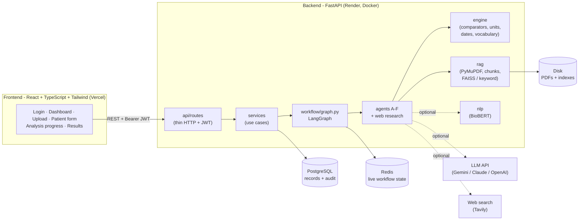
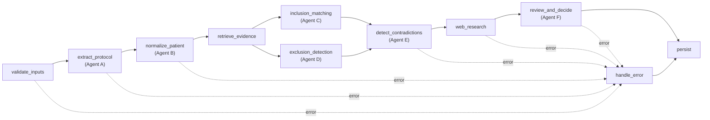

# Clinical Trial Eligibility & Exclusion Contradiction System

An agentic eligibility-support prototype. It reads a clinical trial protocol PDF and a structured patient
profile, evaluates every inclusion and exclusion criterion with specialized agents, detects **Silent Exclusion
Triggers** (a patient who looks eligible at a glance but is excluded by a less obvious criterion), and traces
every decision to the patient value and the protocol text and page that caused it.

> **Disclaimer: decision support, not a medical decision.** This system supports, and does not replace,
> review by a qualified clinician or trial investigator. Every result carries `human_review_required: true` and a
> human-review notice in the API and on every results screen. Final eligibility must be confirmed by the study
> team. All bundled data is synthetic.

| | |
|---|---|
| Author | [Jyothsna1260](https://github.com/Jyothsna1260) |
| GitHub repository | https://github.com/Jyothsna1260/clinical-system |
| Live frontend (Vercel) | _fill in after the Vercel deploy_, e.g. `https://cte-system.vercel.app` (Render static site today: https://cte-system-app.onrender.com) |
| Live API (Render) | https://cte-system-api.onrender.com/docs (free plan: the first request after idle takes about a minute) |
| Demo login (after seeding) | `demo@example.org` / `demo-password-123` (or click **Use the demo account**) |
| Audit and changes | [`AUDIT_REPORT.md`](AUDIT_REPORT.md), [`CHANGELOG.md`](CHANGELOG.md) |
| More docs | [`docs/USER_GUIDE.md`](docs/USER_GUIDE.md), [`docs/ARCHITECTURE.md`](docs/ARCHITECTURE.md), [`docs/DEMO_DATA.md`](docs/DEMO_DATA.md), [`demo/README.md`](demo/README.md) |


---

## Contents

1. [Overview](#overview)
2. [Architecture](#architecture)
3. [The agents](#the-agents)
4. [Traceability](#traceability)
5. [Run locally](#run-locally)
6. [Environment variables](#environment-variables)
7. [API](#api)
8. [Tests and quality checks](#tests-and-quality-checks)
9. [Deploy (Render + Vercel)](#deploy-render--vercel)
10. [Requirements coverage](#requirements-coverage)
11. [Limitations](#limitations)

---

## Overview

A clinician uploads a protocol PDF, enters (or imports) a patient profile, and starts an assessment. The agents
run as a LangGraph workflow, and the results page shows:

- **Overall status**: Eligible / Not Eligible / More Information Required, with a one-line summary of what decided it;
- the inclusion criteria table and the exclusion criteria table, each row expandable to its evidence and reasoning;
- the **patient values used**, with the value as entered and any unit conversion;
- **triggered exclusions**, **missing information** and **silent exclusion triggers**, each in its own section;
- the **protocol evidence** behind the decision, a page viewer with the cited excerpt highlighted, and the final explanation;
- optional extras: web references for ambiguous wording, and what changed since the previous assessment.

### The acceptance scenario (age 69, eGFR 28)

`tests/fixtures/protocol_renal.pdf` is generated, so page numbers are known: page 2 holds the inclusion criteria
and page 3 the exclusion criteria.

| Criterion | Protocol text (page) | Patient (69 y, eGFR 28) | Result |
|---|---|---|---|
| INC-01 | Age 18 to 70 years inclusive (p.2) | 69 | SATISFIED |
| INC-02 | eGFR must not be below 30 mL/min/1.73m2 (p.2) | 28 | UNSATISFIED |
| EXC-01 | Severe renal impairment (p.3), no numeric definition | not documented | UNKNOWN, requires review: *not confirmed by eGFR alone* |

Overall result: **NOT ELIGIBLE**. A renal-domain **Silent Exclusion Trigger** links INC-01 (passed) to INC-02 and
EXC-01 and cites pages 2 and 3. With `protocol_renal_defined.pdf` ("…defined as eGFR below 30"), EXC-01 becomes
**TRIGGERED**. This case is locked in by `tests/test_acceptance.py` and `tests/test_audit_fixes.py`.

### Decision rules (enforced in `app/agents/reviewer.py`)

- A proven exclusion always wins over passing inclusion criteria.
- UNKNOWN is never treated as SATISFIED or NOT_TRIGGERED.
- A missing, stale, conflicting or unusable decisive value gives `MORE_INFORMATION_REQUIRED`, never `ELIGIBLE`.
- `ELIGIBLE` only when every inclusion is SATISFIED, no exclusion is TRIGGERED and no material uncertainty remains.
- Ambiguous wording ("severe", "adequate", unstated range inclusivity) is flagged for review, never silently
  interpreted. A value exactly on a boundary whose inclusivity is unstated evaluates to UNKNOWN.
- Compound criteria ("creatinine > 1.5 mg/dL **or** CrCl < 40 mL/min", "eGFR ≥ 30 **and** ≤ 90") evaluate both
  clauses with three-valued logic, so an undecided clause can never make the criterion pass.
- A diagnosis is never inferred from a lab value unless the protocol defines it that way.
- No model output (LLM or BioBERT) can make a patient ELIGIBLE on its own.

---

## Architecture



**Agent workflow** (`app/workflow/graph.py`). The two matching agents run in parallel; any node failure routes to
`handle_error`, and the run is always saved:



**Code layout.**

```
backend/app/
  main.py               app, middleware (CORS, security headers, upload size), startup recovery
  config.py             settings from environment variables only
  logging_config.py     JSON Lines logging (ids and error types only; no patient data)
  api/routes/           thin routers: auth, trials, patients, eligibility, health   (+ api/errors.py)
  services/             use cases: auth, trials, patients, eligibility, analysis, audit, llm, web_search
  workflow/             state.py (typed LangGraph state), graph.py (the agent graph)
  agents/               protocol_extraction, patient_profile, inclusion_matching, exclusion_detection,
                        contradiction, web_research, reviewer
  engine/               rule_evaluator, comparators, units (validated conversions), dates, vocabulary
  rag/                  pdf_loader, chunker, index (FAISS / keyword), retriever (retrieval validation)
  nlp/                  optional BioBERT concept matcher (review notes only)
  schemas/              clinical.py (domain + agent outputs), api.py (request/response models)
  storage/              repositories: postgres_store.py (DATABASE_URL) or file_store.py; records.py
  state/                live workflow state: Redis (REDIS_URL) or memory
  security/             jwt.py, deps.py (current user), rate_limit.py
frontend/src/
  api/client.ts         typed API client (token, 401 handling, GET retries)
  auth/                 session context, protected routes
  pages/  components/   screens and reusable UI (tables, badges, evidence drawer, step indicator)
  lib/                  routes, formatting, highlighting, patient form mapping, useAsync hook
```

**Where state lives.**

- **During a run:** a typed LangGraph state passes between the agents. Parallel branches merge through reducers
  (logs are appended; the first error wins).
- **Live progress:** each node's start, finish, status and output summary go to Redis (`REDIS_URL`), or to process
  memory if Redis isn't configured.
- **Durable records:** users, trials, protocol documents (page text and extracted criteria), versioned patient
  profiles, runs (result, error, agent logs) and the insert-only audit trail are stored in PostgreSQL
  (`DATABASE_URL`). Without a database URL, they're stored as JSON files under `DATA_DIR/store`.
- **Memory:** extracted criteria are reused per protocol version, and each assessment is compared with the previous
  one for the same patient and trial.

---

## The agents

| Agent | Module | What it does |
|---|---|---|
| **A. Protocol Extraction** | `agents/protocol_extraction.py` | Finds the Inclusion/Exclusion sections (lists, criterion IDs, ruled tables). Turns each item into a `Criterion` with operator, threshold(s), unit and page. Parses compound clauses, and verifies each excerpt appears on its cited page; otherwise it flags the criterion and lowers confidence. With an LLM configured, only the eligibility pages are sent. Output must validate against a strict schema, or the rule-based extractor is used instead. |
| **B. Patient Profile** | `agents/patient_profile.py` | Maps lab names to canonical attributes and converts units with a validated table only (e.g. creatinine µmol/L ÷ 88.4 → mg/dL). Keeps the value as entered. Flags missing, stale (> `STALE_DAYS`), conflicting, undated and unusable values. A newer result that can't be used means an older value is never presented as current. |
| **C. Inclusion Matching** | `agents/inclusion_matching.py` | SATISFIED / UNSATISFIED / UNKNOWN per inclusion criterion. Numeric, range, date and compound rules use deterministic comparators; free-text rules use the LLM (only the data the criterion needs, and only if `LLM_SEMANTIC_EVALUATION=true`). |
| **D. Exclusion Detection** | `agents/exclusion_detection.py` | TRIGGERED / NOT_TRIGGERED / UNKNOWN per exclusion criterion, with the same engine. An undocumented condition is never treated as absent. |
| **E. Contradiction** | `agents/contradiction.py` | Groups criteria by clinical domain (renal, hepatic, cardiac, …). Raises a **Silent Exclusion Trigger** when the patient passes inclusion criteria but a related rule fails or is unresolved. Also records conflicting rules, inconsistent patient values and missing information. |
| Web research (optional) | `agents/web_research.py` | For unresolved criteria with undefined wording, searches the web (Tavily) and attaches references. Only protocol wording is sent, never patient data; the references never change a decision. |
| **F. Decision / Reviewer** | `agents/reviewer.py` | **Evidence gate:** a finding without a verifiable protocol citation is downgraded to UNKNOWN. Then applies the conservative decision table, and records the decisive evidence, the patient values used and what changed since the previous assessment. |

Clinical NLP (optional, `CLINICAL_NLP_ENABLED=true`): a BioBERT sentence model flags differently worded diagnoses
(e.g. "progressive IgA nephropathy" vs "severe renal impairment") as a review note with the similarity score. It
never changes a status.

---

## Traceability

Every decision can be followed from the outcome back to its sources, in the API and in the UI:

| Question | Where to look |
|---|---|
| Which criteria decided the outcome? | `result.decisive_evidence` → "Protocol evidence behind the decision", and the one-line summary on the status card |
| Which patient value was compared? | `CriterionEvaluation.patient_value` + `attribute`; `result.patient_values_used` (value used, observation date, value as entered, conversion note, the criteria it decided) |
| Which protocol text, on which page? | `CriterionEvaluation.evidence_references[]` (`page`, `excerpt`, `source`: verbatim citation or validated retrieval). Click "p. N" to open the page with the excerpt highlighted |
| What did the agent conclude, and why? | `CriterionEvaluation.explanation`, `expected_condition`, `comparison_method`, `uncertainty_notes`; expand a table row |
| Why is a trigger "silent"? | `SilentExclusionTrigger`: passed inclusions, related failing/unknown criteria, patient findings, cited pages |
| Which protocol and patient version were used? | `protocol_version` (`v1-<sha256 prefix>`) and `patient_profile_version` on every run |
| Who did what, when? | `GET /api/eligibility/{id}/audit`: audit events plus the per-agent execution log |

Guarantees: excerpts are verified to appear on their cited page, retrieved passages are kept only if they
contain the criterion's text or key terms, and the reviewer downgrades any decisive finding without a citation.

---

## Run locally

### Option A: Docker Compose (PostgreSQL + Redis + API + UI)

```bash
cp .env.example .env               # then set JWT_SECRET (see the comment in the file)
docker compose up --build          # records in PostgreSQL, workflow state in Redis, PDFs in ./backend/data
# API  http://localhost:8000/docs     UI  http://localhost:5173
docker compose exec backend python -m scripts.seed --api-url http://localhost:8000 --analyze
```

On Linux, create the data folder first so the container user can write to it:
`mkdir -p backend/data && sudo chown 10001 backend/data`.

### Option B: without Docker

```bash
# backend (Python 3.12)
cd backend
python3.12 -m venv .venv && source .venv/bin/activate
pip install -r requirements.txt
python -m scripts.make_synthetic_protocol          # writes tests/fixtures/*.pdf
uvicorn app.main:app --reload --port 8000           # file store in backend/data/; set DATABASE_URL / REDIS_URL for PostgreSQL / Redis
python -m scripts.seed --api-url http://localhost:8000 --analyze   # demo user, data and 9 reference runs

# frontend (Node 20, second terminal)
cd frontend
cp .env.example .env                # VITE_API_URL=http://localhost:8000
npm ci && npm run dev               # http://localhost:5173
```

Demo: log in as `demo@example.org` / `demo-password-123`. Under **New assessment**, choose *SYN-RENAL-001* and
*Synthetic patient A - age 69, eGFR 28*, then run it. The results page shows **NOT ELIGIBLE**, the summary
"Decided by INC-02 …", and a renal Silent Exclusion Trigger citing pages 2 and 3.

---

## Environment variables

Backend variables are read from the environment (or `.env`); `.env.example` lists them all with placeholders. No
secret is hard-coded.

| Variable | Default | Notes |
|---|---|---|
| `APP_ENV` | `development` | `production` refuses to start without a strong `JWT_SECRET` |
| `JWT_SECRET` | dev placeholder | **Required in production**, at least 32 random characters |
| `JWT_EXPIRE_MINUTES` | `720` | Access-token lifetime |
| `DATABASE_URL` | — | PostgreSQL; when set, all records and the audit trail are stored there |
| `REDIS_URL` | — | Redis for live workflow state and auth rate limits; otherwise process memory |
| `RUN_STATE_TTL_SECONDS` | `86400` | How long live workflow state is kept in Redis |
| `STALE_RUN_MINUTES` | `30` | At startup, queued/running runs older than this are marked interrupted |
| `DATA_DIR` | `./data` | Uploaded PDFs, retrieval indexes, and JSON records when `DATABASE_URL` is empty |
| `FRONTEND_ORIGIN` | `http://localhost:5173` | CORS allow-list, comma-separated exact origins |
| `FRONTEND_ORIGIN_REGEX` | — | Optional CORS regex; scope it to your Vercel team (see `.env.example`) |
| `LLM_PROVIDER` | `none` | `gemini` \| `anthropic` \| `openai` \| `none` (offline, rule-based) |
| `LLM_API_KEY` / `LLM_MODEL` | — | Defaults: `gemini-flash-latest` / `claude-opus-5-5` / `gpt-4o-mini`. Free Gemini key: https://aistudio.google.com/apikey |
| `LLM_SEMANTIC_EVALUATION` | `true` | `false`: patient data is never sent to the LLM; free-text criteria become UNKNOWN |
| `EMBEDDINGS_ENABLED` / `EMBEDDING_MODEL` | `true` / `all-MiniLM-L6-v2` | `false` uses the deterministic keyword retriever |
| `CLINICAL_NLP_ENABLED` / `CLINICAL_NLP_MODEL` / `CLINICAL_NLP_THRESHOLD` | `false` / BioBERT STS / `0.75` | Needs about 1 GB RAM |
| `WEB_SEARCH_PROVIDER` / `WEB_SEARCH_API_KEY` / `WEB_SEARCH_MAX_QUERIES` | `none` / — / `3` | `tavily`; free key at https://tavily.com |
| `MAX_UPLOAD_MB` / `MAX_PDF_PAGES` | `20` / `300` | Upload limits (also reported by `/api/health` for the UI) |
| `AUTH_RATE_LIMIT_PER_MINUTE` | `10` | Login/register attempts per IP (and per email for login); `0` disables |
| `STALE_DAYS` | `90` | Lab results older than this are stale |
| `LOG_LEVEL` | `INFO` | |
| `VITE_API_URL` (frontend) | dev: `http://localhost:8000` | **Required for production builds**; baked in at build time |

---

## API

Interactive OpenAPI docs: `/docs`. All endpoints except `health`, `register` and `login` need
`Authorization: Bearer <token>`. Every record is owner-scoped: another user's record returns **404**, so its
existence isn't revealed. Errors always look like `{"error": {"code", "message", "details"}}`.

| Method | Path | Body / query | Returns |
|---|---|---|---|
| POST | `/api/auth/register` | `{email, password (8–128), full_name?}` | 201 `{access_token, token_type, user}`; 409, 429 |
| POST | `/api/auth/login` | `{email, password}` | `{access_token, token_type, user}`; 401, 429 |
| GET | `/api/auth/me` | — | `{id, email, full_name, created_at}` |
| POST | `/api/trials/upload` | multipart `file` (PDF ≤ `MAX_UPLOAD_MB`, ≤ `MAX_PDF_PAGES` pages), `title?` | 201 trial with extracted criteria; 400 `INVALID_FILE_TYPE` / `UNREADABLE_PDF` / `TOO_MANY_PAGES`, 413 |
| GET | `/api/trials`, `/api/trials/{id}`, `/api/trials/{id}/criteria`, `/api/trials/{id}/pages/{page}` | — | trial summaries, detail, criteria, page text |
| POST | `/api/patients` | `{label, profile}` | 201 patient with data-quality flags |
| GET | `/api/patients`, `/api/patients/{id}` | — | patient summaries, latest version |
| PATCH | `/api/patients/{id}` | `{label?, profile}` | creates a **new profile version** |
| POST | `/api/eligibility/analyze` | `{trial_id, patient_id}` | 202 `{run_id, status}`; 409 `TRIAL_NOT_READY` |
| GET | `/api/eligibility?limit=1..100` | — | recent runs |
| GET | `/api/eligibility/{run_id}/status` | — | per-agent progress (live while running) |
| GET | `/api/eligibility/{run_id}` | — | run detail with the typed `EligibilityResult` |
| GET | `/api/eligibility/{run_id}/evidence` | — | every citation behind the result |
| GET | `/api/eligibility/{run_id}/audit` | — | audit events and agent execution logs |
| GET | `/api/health` | — | status, storage and workflow-state backends, LLM / NLP / web-search status, upload limits |

---

## Tests and quality checks

```bash
cd backend
pytest                                   # fully offline: no LLM, keyword retriever, file store
TEST_DATABASE_URL=postgresql://user@localhost:5432/cte_test pytest   # the same suite against PostgreSQL
ruff check .                             # lint (config in pyproject.toml)

cd frontend
npm run lint                             # ESLint (type-aware), zero warnings
npm test                                 # Vitest unit tests for lib/
npm run build                            # TypeScript check + production build
```

Formatters are configured (`ruff format`, black-compatible, in `backend/pyproject.toml`; Prettier in
`frontend/.prettierrc.json`, run with `npm run format`) for new and changed code. The existing code was deliberately
not mass-reformatted, to keep the history reviewable, so `ruff check` and `npm run lint` are the enforced gates.

The backend suite (175 tests) covers:
- the acceptance case and its defined-renal variant;
- every outcome type, with exclusions overriding inclusions;
- unit conversion and boundaries;
- compound criteria;
- the regressions from the audit (`tests/test_audit_fixes.py`);
- upload validation;
- ownership isolation;
- the PostgreSQL and file stores;
- Redis workflow state;
- rate limiting;
- typed API contracts.

---

## Deploy (Render + Vercel)

**Backend → Render.**
1. Push the repo. In Render choose *New → Blueprint* and select `render.yaml`. It creates:
   - the Docker web service (`backend/Dockerfile`; binds `$PORT`, health check `/api/health`);
   - a **PostgreSQL** database (`DATABASE_URL`);
   - a **Key Value / Redis** instance (`REDIS_URL`).
   `JWT_SECRET` is generated.
2. Set `LLM_API_KEY` (Gemini has a free key) and optionally `WEB_SEARCH_API_KEY` when prompted.
3. Seed the deployment: `python -m scripts.seed --api-url https://<render-host> --analyze`.

Free-plan notes:
- 512 MB RAM. Embeddings and BioBERT stay off; the keyword retriever and all agents work unchanged.
- The service sleeps when idle, so the first request takes about a minute. The UI says so and keeps you signed in.
- The free database expires 30 days after creation.
- Uploaded PDF files and indexes live on local disk and are lost on restart. Page text and criteria are in the
  database, so analyses and evidence pages keep working.
- Runs interrupted by a restart are marked as interrupted at the next startup, so you can re-run them.

**Frontend → Vercel.**
1. Import the repo in Vercel with root directory `frontend` (framework preset: Vite).
2. Set the environment variable `VITE_API_URL=https://<render-host>` and deploy. A production build without it
   shows a configuration error instead of silently calling localhost. `frontend/vercel.json` provides the SPA rewrite.
3. Add the Vercel production URL to `FRONTEND_ORIGIN` on the Render service. `render.yaml` already lists
   `https://cte-system.vercel.app`. For preview deployments, add a `FRONTEND_ORIGIN_REGEX` scoped to your team
   slug (see the comment in `render.yaml`).
4. Record both URLs in the table at the top of this README.

**Alternative.** The blueprint also defines a Render static site (`cte-system-app`).

---

## Requirements coverage

| Requirement | Where it is met |
|---|---|
| Protocol Extraction Agent | `agents/protocol_extraction.py` |
| Patient Profile Agent | `agents/patient_profile.py`, `engine/units.py`, `engine/vocabulary.py` |
| Inclusion Matching / Exclusion Detection Agents | `agents/inclusion_matching.py`, `agents/exclusion_detection.py`, `engine/rule_evaluator.py` |
| Contradiction Agent (silent exclusion triggers, conflicting criteria) | `agents/contradiction.py` |
| Decision / Reviewer Agent (final status, evidence validation) | `agents/reviewer.py` |
| 69-year-old / eGFR 28 example | `tests/test_acceptance.py`, `tests/test_audit_fixes.py` |
| Python, FastAPI, Pydantic, async APIs | `backend/app/`; blocking work runs in worker threads or background tasks |
| LangGraph orchestration | `workflow/graph.py` |
| LLM API (Gemini / Claude / OpenAI) | `services/llm.py` |
| ClinicalBERT / BioBERT where appropriate | `nlp/clinical.py` (advisory concept matching) |
| Sentence Transformers, FAISS, RAG | `rag/` |
| PostgreSQL | `storage/postgres_store.py` |
| Redis / workflow state | `state/run_state.py`, `workflow/state.py` |
| Short-term and persistent agent memory | LangGraph state + Redis; stored criteria per protocol version; prior-assessment comparison |
| Web Search API | `services/web_search.py`, `agents/web_research.py` |
| PDF processing | `rag/pdf_loader.py` |
| JWT authentication | `security/jwt.py`, `security/deps.py`, `security/rate_limit.py` |
| React, TypeScript, Tailwind | `frontend/src/` |
| Results UI (status, both tables, patient values, triggered exclusions, missing info, silent triggers, protocol evidence, explanation) | `frontend/src/pages/Results.tsx`, `components/CriteriaTable.tsx` |
| Traceability | [Traceability](#traceability) |
| Not an independent medical decision | Disclaimer on every result (API + UI) |
| Render + Vercel deployment | `render.yaml`, `frontend/vercel.json` |

---

## Limitations

- **Runs and storage:**
  - Runs execute in FastAPI background tasks, not a job queue. A run interrupted by a restart is marked failed at
    the next startup and must be re-run.
  - No roles or refresh tokens.
  - The file store is for one API process. Use PostgreSQL (and Redis) to run several workers.
  - Uploaded PDF files and retrieval indexes stay on local disk; a multi-host deployment would move them to
    object storage.
- **Rule-based extraction:**
  - It targets numbered/bulleted lists and ruled tables with common phrasings ("not below", "at least", "≥",
    ranges, "within N days", two-clause and/or).
  - Non-numeric trailing clauses (e.g. "eGFR ≥ 30 and no dialysis") evaluate only the numeric part.
  - Unusual layouts need the LLM path or manual review. Scanned PDFs without a text layer are rejected.
- **Other evaluation limits:**
  - ULN-relative thresholds ("ALT > 3 × ULN") need the patient's reference range and are left for review.
  - The condition vocabulary and domain map are small, hand-curated tables. A production system would map to
    SNOMED CT / ICD-10 / LOINC.
- **Not a medical decision:** model confidence is never presented as clinical certainty, and final eligibility
  always requires study-team review.
